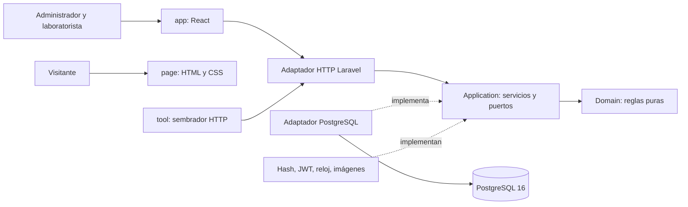

# Arquitectura

Diseño objetivo, pendiente de implementación. Monolito modular con arquitectura hexagonal. React consume HTTP; Laravel adapta peticiones a casos de uso; PostgreSQL persiste el negocio. La página pública no consume la API.



## Estructura prevista

```text
api/
  composer.json
  artisan
  bootstrap/app.php
  app/Providers/LabServiceProvider.php
  src/
    Domain/          Equipment, Loan, LoanItem, Researcher, User, ValueObjects
    Application/     Ports, Services, DTOs
    Adapters/        Http, Persistence, Security, Storage, Time
  database/migrations/
  routes/api.php
  tests/             Unit, Application, Integration, Contract, Architecture
app/src/             api, auth, components, features
page/                index.html, assets
infra/               compose.yaml, Dockerfiles, configuración de servicios
tool/                sembrador, concurrencia y carga
```

`api/composer.json` se ubica directamente en la carpeta exigida; debe declarar `laravel/framework`. No se usará una subcarpeta `backend` que oculte al evaluador el producto. `Domain` no depende de `Application`; `Application` no importa `Adapters`; los adaptadores implementan interfaces de aplicación. Solo el proveedor compone instancias de infraestructura.

## Puertos y agregados

Puertos previstos: `EquipmentRepository`, `ResearcherRepository`, `UserRepository`, `LoanRepository`, `ReportReader`, `TransactionManager`, `Clock`, `PasswordHasher`, `TokenIssuer`, `CoverStorage`, `IdGenerator`. Ninguna firma expone un modelo Eloquent, un Request, Builder o conexión PDO.

`Equipment` garantiza existencias en rango; `Loan` controla líneas, fecha de vencimiento y devolución única; `Researcher` define nombre/documento; `User` normaliza usuario y rol. La aplicación verifica reglas que cruzan agregados, como el total pendiente y los vencidos del investigador.

Cada servicio realiza una acción: `LoginService`, `CreateLabTechnicianService`, `CreateEquipmentService`, `UpdateEquipmentService`, `SearchEquipmentService`, `RetireEquipmentService`, `UploadCoverService`, `RemoveCoverService`, `CreateResearcherService`, `LendEquipmentService`, `ReturnItemService`, `ListOverdueService`, `MostBorrowedReportService` y consultas de detalle/listado.

## Flujo de préstamo y concurrencia

1. HTTP autentica, autoriza y valida estructura.
2. La aplicación abre una transacción y serializa operaciones del mismo investigador mediante un bloqueo transaccional asesor.
3. Consulta pendientes y vencidos bajo ese bloqueo; carga equipos activos por lote y captura sus `xmin`.
4. Dominio calcula el préstamo, snapshots, cinco días y descuentos.
5. El adaptador actualiza cada equipo condicionado a id, `xmin`, activo y disponibilidad, con orden estable de ids.
6. Inserta cabecera y líneas. Si un descuento falla, rollback de toda la transacción y 409.
7. Confirma y devuelve 201. El testigo no se reutiliza en otra solicitud ni se expone al cliente.

El bloqueo por investigador también se aplica a devoluciones para mantener consistentes sus pendientes. No bloquea todos los investigadores. La devolución condiciona `returned_at IS NULL` e incrementa existencias dentro de la misma transacción; si otra devolución ganó, responde 409. Edición de total, baja y préstamos deben compartir una estrategia de escritura que respete el stock y la versión; se comprobarán sus carreras en integración.

Errores propios del dominio/aplicación se convierten al contrato únicamente en HTTP. El reporte se resuelve mediante una consulta agregada de `loan` y `loan_item`, sin cargar el catálogo para sustituir snapshots. No se añaden colas, Redis, microservicios ni almacenamiento de reportes.
