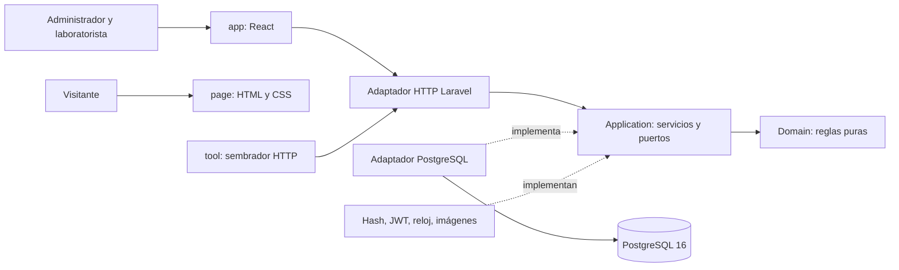

# Arquitectura

Diseño objetivo. Al 17 de noviembre están implementados el arranque Laravel, la migración PostgreSQL, los objetos del dominio y los casos de login/creación de laboratoristas con fakes (T-01 a T-07). T-08 verifica servicios de investigadores, catálogo y fotografías con fakes; T-09 verifica alta de préstamos y rollback con fakes. También están verificados los adaptadores reales de hash/JWT, almacenamiento local y repositorios/lectores PostgreSQL de T-12, compuestos únicamente en LabServiceProvider. Persistencia de préstamos, demás servicios e interfaces siguen pendientes. Monolito modular con arquitectura hexagonal. React consumirá HTTP; Laravel adaptará peticiones a casos de uso; PostgreSQL persistirá el negocio. La página pública no consumirá la API.



## Estructura prevista

```text
api/
  composer.json
  artisan
  bootstrap/app.php
  app/Providers/LabServiceProvider.php
  src/
    Domain/          Equipment, Loan, LoanItem, Researcher, User, ValueObjects
    Application/     Ports, Services, DTOs
    Adapters/        Http, Persistence, Security, Storage, Time
  database/migrations/
  routes/api.php
  tests/             Unit, Application, Integration, Contract, Architecture
app/src/             api, auth, components, features
page/                index.html, assets
infra/               compose.yaml, Dockerfiles, configuración de servicios
tool/                sembrador, concurrencia y carga
```

`api/composer.json` se ubica directamente en la carpeta exigida; debe declarar `laravel/framework`. No se usará una subcarpeta `backend` que oculte al evaluador el producto. `Domain` no depende de `Application`; `Application` no importa `Adapters`; los adaptadores implementan interfaces de aplicación. Solo el proveedor compone instancias de infraestructura.

## Puertos y agregados

Puertos previstos: `EquipmentRepository`, `ResearcherRepository`, `UserRepository`, `LoanRepository`, `ReportReader`, `TransactionManager`, `Clock`, `PasswordHasher`, `TokenIssuer`, `CoverStorage`, `IdGenerator`. Ninguna firma expone un modelo Eloquent, un Request, Builder o conexión PDO.

`Equipment` garantiza existencias en rango; `Loan` controla líneas, fecha de vencimiento y devolución única; `Researcher` define nombre/documento; `User` normaliza usuario y rol. La aplicación verifica reglas que cruzan agregados, como el total pendiente y los vencidos del investigador.

Los objetos del dominio implementados son inmutables: retirar, restituir, editar, dar de baja y devolver generan una nueva instancia válida. El servicio de aplicación deberá guardar explícitamente la instancia resultante dentro de la transacción. El dominio recibe instantes explícitos; no consulta el reloj del sistema ni conoce el puerto `Clock`. La normalización de usuario se comparte mediante `User::normalizeUsername`; el hash es privado y queda excluido de su representación JSON y depuración. Esto no sustituye las pruebas posteriores de seguridad HTTP y logs.

Cada servicio realiza una acción: `LoginService`, `CreateLabTechnicianService`, `CreateEquipmentService`, `UpdateEquipmentService`, `SearchEquipmentService`, `RetireEquipmentService`, `UploadCoverService`, `RemoveCoverService`, `CreateResearcherService`, `LendEquipmentService`, `ReturnItemService`, `ListOverdueService`, `MostBorrowedReportService` y consultas de detalle/listado.

## Flujo de préstamo y concurrencia

T-09 implementa `LendEquipmentService` con puertos propios. `TransactionManager::forResearcher` define una transacción que serializa las operaciones del mismo investigador antes del callback y revierte cualquier `Throwable`. El servicio lee Clock y pendientes dentro de ese callback, valida todos los equipos activos antes de vencidos/límite/stock, escribe equipos en orden de id y agrega la cabecera con sus líneas congeladas. Conserva el orden de líneas solicitado en la respuesta. `DomainViolation::context` transporta el dato de negocio `active_loans` al exceder el límite; el futuro adaptador HTTP lo convertirá en `details`, sin importar HTTP en el núcleo.

El fake de T-09 restaura las colecciones de equipos y préstamos y libera su marca de bloqueo tras un fallo. Esto prueba la coordinación del caso de uso y sus errores; no demuestra aislamiento entre procesos. Los adaptadores PostgreSQL de `LoanRepository` y `TransactionManager`, su composición y carreras siguen pendientes de T-13/T-17. La sintaxis UUID, los campos adicionales y la autenticación de la petición se comprobarán en T-16; el operador y la fecha no son argumentos libres del cliente en este servicio.

T-12 verifica escrituras de catálogo condicionadas por `xmin`, id, referencia inmutable y estado activo. `xmin` identifica la transacción que escribió la fila; no es un contador por sentencia dentro de una misma transacción. La prueba de versión usa escrituras confirmadas por separado. No se reutilizará un testigo antiguo para sucesivas modificaciones del mismo equipo dentro de una transacción. Las carreras reales y su traducción HTTP siguen pendientes de T-13/T-16.

Los lectores de T-12 calculan total y página en una sola sentencia para compartir la misma instantánea. Ordenan por nombre con collation `C` e id para desempatar, conservan el total en páginas vacías y escapan `%`, `_` y `!` en búsquedas literales. Las entradas son parámetros SQL; las únicas piezas SQL compuestas proceden de constantes internas de los adaptadores.

1. HTTP autentica, autoriza y valida estructura.
2. La aplicación abre una transacción y serializa operaciones del mismo investigador mediante un bloqueo transaccional asesor.
3. Consulta pendientes y vencidos bajo ese bloqueo; carga equipos activos por lote y captura sus `xmin`.
4. Dominio calcula el préstamo, snapshots, cinco días y descuentos.
5. El adaptador actualiza cada equipo condicionado a id, `xmin`, activo y disponibilidad, con orden estable de ids.
6. Inserta cabecera y líneas. Si un descuento falla, rollback de toda la transacción y 409.
7. Confirma y devuelve 201. El testigo no se reutiliza en otra solicitud ni se expone al cliente.

El bloqueo por investigador también se aplica a devoluciones para mantener consistentes sus pendientes. No bloquea todos los investigadores. La devolución condiciona `returned_at IS NULL` e incrementa existencias dentro de la misma transacción; si otra devolución ganó, responde 409. Edición de total, baja y préstamos deben compartir una estrategia de escritura que respete el stock y la versión; se comprobarán sus carreras en integración.

Errores propios del dominio/aplicación se convierten al contrato únicamente en HTTP. El reporte se resuelve mediante una consulta agregada de `loan` y `loan_item`, sin cargar el catálogo para sustituir snapshots. No se añaden colas, Redis, microservicios ni almacenamiento de reportes.
