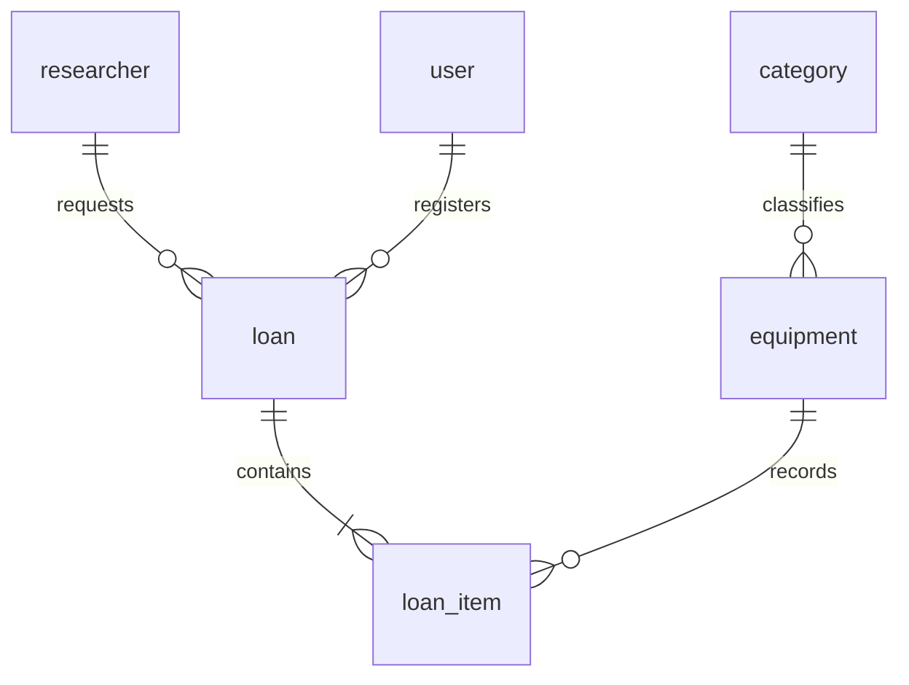

# Modelo de datos

Migración inicial implementada y verificada el 14 de noviembre (T-02). Motor previsto: PostgreSQL 16, esquema `lab_equipment`, zona UTC. Los CHECK adicionales de T-18 se aplicaron y verificaron en PostgreSQL el 16 de noviembre.

## Convenciones y relaciones

Seis tablas de negocio en singular; nombres y columnas en inglés. UUID v4 generados por la aplicación; instantes `timestamptz`; ninguna columna de negocio con `DEFAULT`, `created_at` o `updated_at`. Laravel puede mantener su registro técnico `public.migrations` fuera del esquema del negocio; no se confunde con una entidad ni se crean las tablas de ejemplo de sesiones, colas, caché o recuperación de contraseña.



## Diccionario físico

Todas las columnas son NOT NULL salvo las indicadas con `sí`. PK significa clave primaria.

| Tabla | Columna | Tipo | Nulable | Propósito |
|---|---|---|---|---|
| category | id | uuid | no | PK fija de semilla |
| category | name | varchar(120) | no | Nombre único |
| equipment | id | uuid | no | PK |
| equipment | name | varchar(250) | no | Nombre recortado |
| equipment | manufacturer | varchar(200) | no | Fabricante; equivalente de autor |
| equipment | reference | varchar(64) | no | Referencia normalizada, no número de serie por unidad |
| equipment | category_id | uuid | no | FK category |
| equipment | total_units | integer | no | Unidades totales >= 1 |
| equipment | available_units | integer | no | Unidades disponibles |
| equipment | cover_key | varchar(512) | sí | Clave opaca de fotografía o null |
| equipment | deleted_at | timestamptz | sí | Baja lógica |
| researcher | id | uuid | no | PK |
| researcher | full_name | varchar(200) | no | Nombre |
| researcher | document_number | varchar(30) | no | Documento único, recortado |
| loan | id | uuid | no | PK |
| loan | researcher_id | uuid | no | FK researcher |
| loan | loaned_by_user_id | uuid | no | FK user; identidad del token |
| loan | loaned_at | timestamptz | no | Instante del Clock |
| loan_item | id | uuid | no | PK |
| loan_item | loan_id | uuid | no | FK loan |
| loan_item | equipment_id | uuid | no | FK equipment |
| loan_item | equipment_name | varchar(250) | no | Nombre congelado |
| loan_item | reference | varchar(64) | no | Referencia congelada |
| loan_item | category_name | varchar(120) | no | Categoría congelada, sin FK |
| loan_item | due_at | timestamptz | no | loaned_at + cinco días |
| loan_item | returned_at | timestamptz | sí | Única modificación del hecho prestado |
| user | id | uuid | no | PK |
| user | username | varchar(120) | no | Recortado, minúsculas, único |
| user | password_hash | varchar(512) | no | Hash Argon2id, secreto |
| user | role | varchar(40) | no | admin o lab_technician |

`lab_equipment."user"` se entrecomilla en SQL. No hay tabla para unidades individuales, fotografías, devoluciones, reportes ni auditoría. `status`, `active_loans` y `days_late` son valores calculados. `xmin` es una columna interna ya existente de PostgreSQL; se usa temporalmente como testigo de versión, no se añade una columna `version`.

## Restricciones e índices

| Objeto | Regla | Estado actual |
|---|---|---|
| Seis PK | UUID únicos | motor (verificado 14/11) |
| UNIQUE category.name, researcher.document_number, user.username | Evitar duplicados | motor (verificado 14/11) |
| uq_equipment_active_reference | UNIQUE(reference) WHERE deleted_at IS NULL | motor (verificado 14/11) |
| uq_loan_item_equipment | UNIQUE(loan_id, equipment_id) | motor (verificado 14/11) |
| ck_equipment_available_range | available_units >= 0 AND available_units <= total_units | motor (verificado 14/11) |
| ck_equipment_total_positive | total_units >= 1 | motor (verificado 16/11) |
| ck_user_role | role IN ('admin','lab_technician') | motor (verificado 16/11) |
| ck_equipment_reference | Referencia normalizada conforme al contrato | motor (verificado 14/11) |
| ck_user_username | Nombre no vacío, normalizado | motor (verificado 14/11) |
| ck_equipment_cover_key | NULL o cadena no vacía | motor (verificado 14/11) |
| FK equipment.category_id | category.id, DELETE RESTRICT | motor (verificado 14/11) |
| FK loan.researcher_id | researcher.id, DELETE RESTRICT | motor (verificado 14/11) |
| FK loan.loaned_by_user_id | user.id, DELETE RESTRICT | motor (verificado 14/11) |
| FK loan_item.loan_id | loan.id, DELETE CASCADE por composición; ninguna operación borra préstamos | motor (verificado 14/11) |
| FK loan_item.equipment_id | equipment.id, DELETE RESTRICT | motor (verificado 14/11) |
| Índice equipment(category_id, name) | Parcial sobre activos | motor (verificado 14/11) |
| Índice loan(loaned_at), loan(researcher_id), loan(loaned_by_user_id) | Listado y pendientes de investigador | motor (verificado 14/11) |
| Índice loan_item(equipment_id) | Referencias históricas | motor (verificado 14/11) |
| Índice loan_item(due_at) | Parcial WHERE returned_at IS NULL | motor (verificado 14/11) |

Todas las FK usan ON UPDATE NO ACTION. Las reglas de máximo dos pendientes, ausencia de vencidos, una o dos líneas, fechas de vencimiento y atomicidad se implementarán en dominio/aplicación/transacciones (T-05, T-09 y T-13); un CHECK de una fila no puede contar otras filas. No se afirmará que la base ya las impone.

## Semilla y privacidad

| UUID fijo | Nombre |
|---|---|
| 11111111-1111-4111-8111-111111111111 | medición |
| 22222222-2222-4222-8222-222222222222 | óptica |
| 33333333-3333-4333-8333-333333333333 | electrónica |
| 44444444-4444-4444-8444-444444444444 | química |
| 55555555-5555-4555-8555-555555555555 | seguridad |

Estas categorías se insertan mediante migración. El administrador se aprovisiona en el arranque con credenciales de entorno y el puerto de hash. Los demás datos de demostración entran por la API, nunca mediante SQL del sembrador.

Investigadores y operadores son datos restringidos a roles autorizados; el reporte no revela sus identidades. Los préstamos y líneas se conservan. El catálogo solo se da de baja. Al quitar una foto se confirma primero `cover_key = null` y después se elimina el binario, sin destruir otra portada si hay una operación concurrente.

## Verificación prevista del esquema

El esquema se inspeccionó el 14 de noviembre; estas consultas permiten repetir la inspección:

```sql
SELECT table_name, column_name, data_type, is_nullable, column_default
FROM information_schema.columns
WHERE table_schema = 'lab_equipment'
ORDER BY table_name, ordinal_position;

SELECT c.conrelid::regclass, c.conname, pg_get_constraintdef(c.oid)
FROM pg_constraint c JOIN pg_namespace n ON n.oid = c.connamespace
WHERE n.nspname = 'lab_equipment'
ORDER BY 1, 2;

SELECT tablename, indexname, indexdef
FROM pg_indexes WHERE schemaname = 'lab_equipment'
ORDER BY 1, 2;
```

La evidencia debe comprobar seis tablas de negocio, ausencia de DEFAULT, columnas exactas, categorías exactas y rechazo de escrituras inválidas. Una discrepancia se registra y corrige; no se oculta ajustando el documento para admitir extras.
